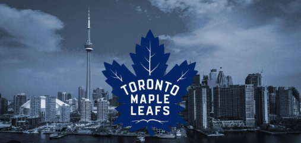

## Current State of the NHL

As a Canadian and die-hard hockey fan, particularly of the Toronto Maple Leafs, I've always followed the NHL closely. The 2026–27 season has already been an eventful one, with several major trades, signings, and roster changes across the league. I wanted to highlight three moves that have particularly caught my attention, along with their potential impact on the teams involved and the broader NHL landscape.

### Three NHL Moves That Have Caught My Attention

1. Kirill Marchenko to the Toronto Maple Leafs: Toronto made a major statement by acquiring Kirill Marchenko from the Columbus Blue Jackets in a blockbuster deal that sent Matthew Knies the other way. Marchenko brings an exciting offensive presence to Toronto, but giving up a young power forward like Knies makes this a particularly fascinating gamble. As a Leafs fan, I'm interested to see whether this move can finally help push Toronto toward a deeper playoff run.

2. Connor Hellebuyck to the New Jersey Devils: One of the biggest surprises of the season was Winnipeg trading superstar goaltender Connor Hellebuyck to New Jersey. A former Vezina Trophy winner, Hellebuyck gives the Devils an elite presence between the pipes and could be the missing piece for a team looking to establish itself as a legitimate Stanley Cup contender.

3. Brady Tkachuk to the Florida Panthers: Florida made a massive statement by acquiring Ottawa Senators captain Brady Tkachuk. Reuniting him with his brother Matthew creates an intimidating forward group and adds another layer of physicality and offensive firepower to an already competitive Panthers team. It will be interesting to see how this move impacts the balance of power in the Eastern Conference.